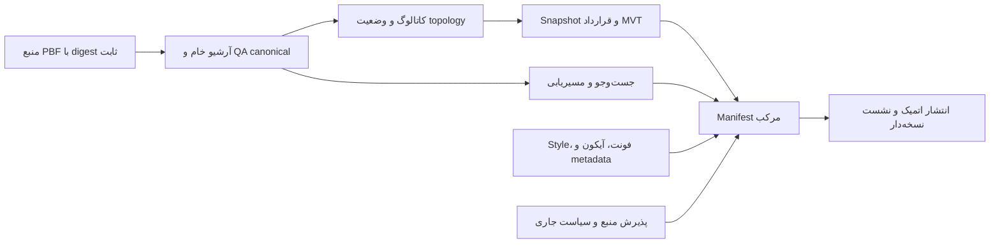

# پیشنهاد N-11: ساخت مرحله‌ای و استفادهٔ مجدد از خروجی معتبر

این سند طرح ادامهٔ کار است و قابلیت اجراشده نیست. سازندهٔ فعلی fingerprint یکپارچه دارد؛ تغییر صرف متن TileJSON نیز ساخت سنگین تازه ایجاد می‌کند. retry محدود تراکنش metadata، این وابستگی را برطرف نمی‌کند. اجرای ایرانِ مرحلهٔ چهارم با همین سازندهٔ فعلی انجام می‌شود.

## واحد نسخه

نسخهٔ قابل استفادهٔ کاربر، manifest مرکب است. دادهٔ خام، کاتالوگ هندسی، snapshot کاشی، metadata، جست‌وجو، مسیریابی و assets می‌توانند artifactهای مستقل داشته باشند؛ انتشار manifest همچنان یک commit اتمیک دارد. نشست به digest همین manifest متصل می‌شود. تغییر کوچک نباید الزاماً import کامل دادهٔ خام را تکرار کند، اما هر تغییر باید gates مرتبط را دوباره بگذراند.

پذیرش منبع و permission انتشار، gate اختیار هستند؛ وجود artifact در cache، این اختیار را صادر یا تمدید نمی‌کند. مثلاً raw معتبرِ منبع آزمایشی می‌تواند برای آزمایش بعدی مفید باشد، اما اجازهٔ انتشار عملیاتی از آن استنتاج نمی‌شود.

## وابستگی‌ها و کلید cache

| Artifact | وابستگی‌های مؤثر پیشنهادی | QA لازم |
|---|---|---|
| Raw | digest منبع، قرارداد raw، نسخهٔ importer و الگوریتم canonical | شمارش، digest همهٔ primitives، ترتیب ارجاع‌ها و metadata موجود |
| Catalog | Raw، قواعد کاتالوگ و topology، نسخهٔ مبدل هندسه و منابع مکمل | حسابرسی مستقل family، اعتبار هندسه، closure و عدم حذف خاموش |
| Serving | Catalog، قواعد کنارگذاری، قرارداد MVT و SQL کاشی | شمارش snapshot، مجوزها، ایندکس و برابری SQL/HTTP |
| Search/routing | منبع سازگار، image موتور و تنظیمات/پروفایل | قرارداد پاسخ، پوشش دامنه و سازگاری source/version |
| Assets/metadata | digest فایل‌ها و قرارداد لایه/attribute/zoom | فونت و آیکون، اعتبار style، attribution و پذیرش بصری |
| Manifest | همهٔ وابستگی‌های فوق و سیاست پذیرش جاری | کامل‌بودن موتورها، سازگاری منبع، امضا و gates انتشار |

کلید باید از ساختار نسخه‌دار و canonical شامل digest وابستگی‌ها ساخته شود؛ نام فایل، timestamp، نام job یا برچسب image کافی نیست. بازاستفاده از snapshot فیزیکی Postgres نیز به سازگاری image/نسخه/فرمت ذخیره‌سازی وابسته است؛ digest منطقی raw به‌تنهایی قابلیت mount یک datadir روی موتور دیگر را ثابت نمی‌کند. انتخاب فرمت قابل‌حمل آرشیو خام و روش restore باید جدا benchmark و تصویب شود.

اطلاعات نمایشی HTTP بهتر است بدون ویرایش هندسهٔ مهرشده به manifest/assets متصل شود. تغییر attribution همچنان نیازمند کنترل دقیق متن و پاسخ HTTP است. تغییر policy کنارگذاری یا semantics هندسی، صرفاً metadata محسوب نمی‌شود و QA وابسته را باطل می‌کند.

## بازیابی و مرز امنیت

- فقط خروجی نهایی‌شده، فاقد writer فعال و دارای identity، dependency digest و QA معتبر قابل reuse است. cache از بیرون مرز اعتماد می‌آید و پیش از مصرف دوباره بررسی می‌شود.
- job ناموفق دوباره موفق نام‌گذاری نمی‌شود. تلاش تازه با fencing تازه می‌تواند به ancestor معتبر ارجاع دهد؛ رکورد شکست، رویدادها و دلیل adoption حفظ می‌شوند. دیتابیس در حال تغییر یا خروجی نیمه‌تمام قابل adoption نیست.
- اثر تغییر هر وابستگی تا همهٔ descendants محاسبه می‌شود. artifact قدیمی که قراردادش سازگار نیست وارد manifest تازه نمی‌شود. cache miss و خرابی cache باید به ساخت معتبر یا توقف منجر شوند.
- کپی فایل mutable با hard link، snapshot مستقل داده نیست. فرمت ذخیره‌سازی و انتقال باید immutability واقعی، کنترل هویت و آزمون خراب‌کردن نسخهٔ کپی را داشته باشند. sharing محدود dependency در آزمایشگاه فعلی راهکار snapshot دیتابیس نیست.
- امضا و provenance باید artifact، ورودی‌ها، ابزار، QA و scope را به هم متصل کنند. اشتراک Unix owner یا checksum محلی، جای هویت مستقل و اعتبار ناشر را نمی‌گیرد.

## retention و معیار پذیرش

نگهداری سه release اخیر، حفاظت نشست‌ها و inflightها همچنان برقرار است. GC باید از همهٔ releaseهای محافظت‌شده و jobهای معتبر روی گراف حرکت کند و ancestorهای مشترک را نگه دارد. حذف release قدیمی به معنی آزادبودن Raw مشترک آن نیست. بودجهٔ موقت، restore، WAL، index و backup باید پیش از پذیرش build رزرو شود؛ در کمبود ظرفیت، ساخت تازه متوقف می‌شود.

برای بستن N-11 باید دست‌کم این موارد واقعاً آزموده شوند:

1. تغییر فقط metadata، بدون raw import و بدون بازسازی هندسه، با پاسخ HTTP درست و نشست قبلی سالم منتشر شود.
2. تغییر rule کاتالوگ، descendants لازم را بازسازی کند و reuse خام فقط با digest و QA معتبر انجام شود.
3. artifact خراب، signature نامعتبر، منبع ناسازگار و QA قدیمی پیش از انتشار رد شوند.
4. crash پس از یک checkpoint معتبر، تلاش تازه را با fencing تازه و حفظ شکست پیشین ادامه دهد؛ writer قدیمی نتواند نتیجهٔ تازه را تغییر دهد.
5. GC هم‌زمان با نشست/ساخت/reuse، artifact مشترک یا محافظت‌شده را حذف نکند؛ خرابی control plane حذف را متوقف کند.
6. زمان، peak storage و هزینهٔ I/O نسبت به سازندهٔ یکپارچه روی workload ثابت اندازه‌گیری شود.

ابتدا قرارداد artifact و migration کنترلر باید با بررسی تهدید و آزمون خرابی طراحی شود. این پیشنهاد مجوز bypass کردن QA، ویرایش pipeline در حال اجرا یا بازیابی موردی دیتابیس‌های ناموفق فعلی نیست.
